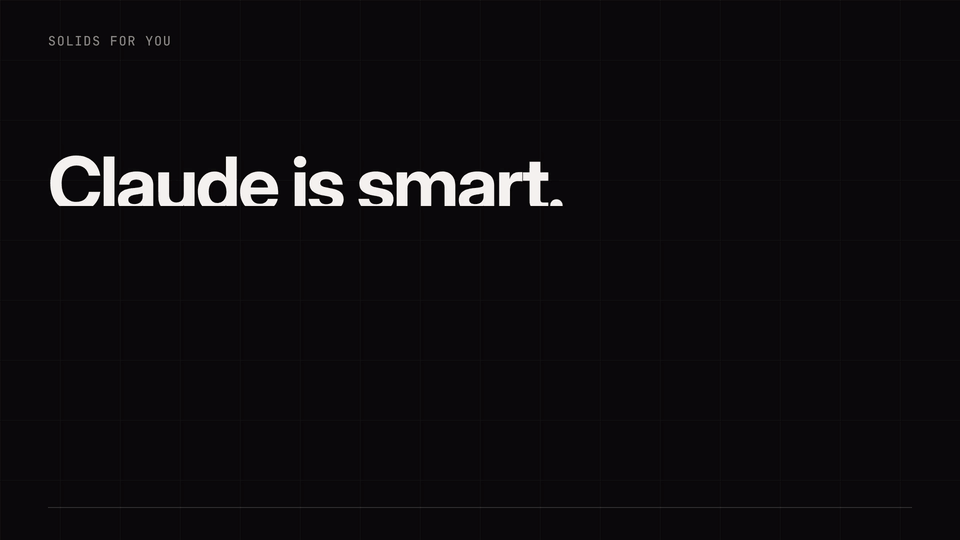

# Example: the launch video, made by the Master Skill's video workflow

The video at the top of the README was made by Claude with the SOLIDS FOR
YOU video workflow, start to finish: a brief, a style spec and scene plan, a
build in HTML rendered frame by frame, a harsh buyer review, a motion design
review and an audio review after every draft, and three rounds of fixes. The
GIF is the silent version; the full video has music and sound effects.

## The brief

- **Goal:** in about 30 seconds, a founder on GitHub or X understands "11
  Claude specialists for founders, installed in two commands, free" and
  stars or installs it.
- **Format:** 1920 × 1080, 30 fps, 32 s. Must work on mute (README GIFs and
  most social autoplay are silent).
- **Style:** the motion taste notes in `taste/motion/` (dark navy, blue glow,
  floating cards, spaced capital labels, big numbers, progress rings, 2D only).
- **Rule:** no invented claims. The cards are labelled "example outputs";
  the ₹259 is the real result in [`../ecom-unit-economics`](../ecom-unit-economics).

## Rounds

| Round | What changed | Motion design score |
|---|---|---|
| Draft 1 | First render | 71 |
| Round 1 | Old scene exits before the next enters (the text overlapped for 7 frames); results appear one beat sooner (cards sat empty for a second); numbers count up with their ring; music EQ'd for phone speakers (it was bass-heavy, centroid 447 Hz to 798 Hz); bigger labels | 79 |
| Round 2 | The card frame and ring stay put while the content changes, so five tools read as one product; a progress bar fills per tool; one slow push-in so nothing stands still; bigger text for phones | 82 |
| Round 3 | Title words arrive one by one, the subtitle a beat sooner; first frame fixed to work as a thumbnail | 83 |

**Final: 83 out of 100, two points under the workflow's bar of 85.** The
workflow stops after three rounds and says what's left, so here it is: the
cards show what each tool returns, not a screen recording of Claude doing
it. A real session recording in the card would make it more believable and
is the next fix.

| Criterion (weight) | Score | Evidence |
|---|---|---|
| Hook (1.5) | 9 | Words move from frame 0; "solid." lands on beat 2 (0.93 s) with an impact; the point is clear by 1.4 s |
| Clarity (1.5) | 8 | One tool per card, one result, one number |
| Motion purpose (1.2) | 8 | Shared card frame and ring, count-ups tied to the ring, "solid." callback at the end |
| Timing and easing (1.2) | 8 | 12 to 14 frame ease-out entrances, 8 frame ease-in exits, 3 frame staggers, overshoot only on "solid." |
| Rhythm and sync (1.0) | 9 | Every scene change on a bar of the music (8 beats per tool); every effect on its sync point; no static stretch |
| Typography (1.0) | 8 | Two typefaces; cards hold 3.7 s for about 10 words; small labels are hard to read on a phone |
| Layout (0.8) | 8 | One 160 px margin and grid throughout |
| Colour and finish (0.6) | 8 | Navy, one blue accent, red only for "Not yet."; grain against banding |
| Audio (0.6) | 8 | -13.9 LUFS, -1.6 dBTP, no clipping |
| Works on mute and ending (0.6) | 9 | Text carries everything; ends on the URL and "Star it on GitHub" |

**Harsh buyer (a founder scrolling X):** watches to the end on mute, because
every card is one line and one number and it's on the beat. Biggest
objection: "these are example outputs; show me it working." This folder and
[`../ecom-unit-economics`](../ecom-unit-economics) are the answer to that.

## Sound

Both from the SOLIDS FOR YOU sound library
(`plugins/master/skills/master/sounds/`), both CC0, so no credit is required:

- **Music:** "Dear Mr Super Computer" by HoliznaCC0, via
  [alvana-audio](https://github.com/seyedpouramir/alvana-audio). It starts at
  7.363 s so the video opens at full energy, and is EQ'd for phones.
- **Effects:** [wyzowl/sfx-kit](https://github.com/wyzowl/sfx-kit): whooshes,
  pops, an impact, typing and a tech logo sting, each placed on its sync
  point.

## Rebuild it

`source/` has the scene (`scene.html`), the beat grid (`beats.json`) and the
sound cues (`cues.json`, paths relative to the sound library's download
folder). Replace `__BEATS__` in the scene with the `beats` list, fetch the
sounds with `get_sounds.py fetch sfx-kit` and `get_sounds.py fetch alvana
--category music-tech`, mix with `sfx_mix.py` and render with
`render_html_video.cjs`.
